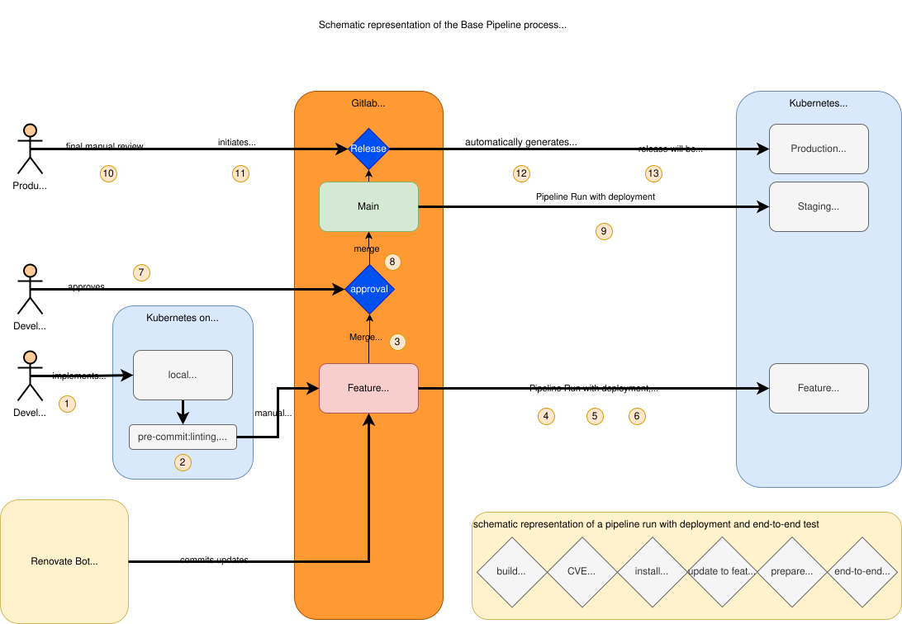

# base-pipeline

This project provides reusable **GitLab CI building blocks** (Docker images + `include`-able YAML files) that let other projects pull build, scan, test, release, and deployment jobs into their own pipeline without having to maintain that logic themselves.

For more background on the overall architecture (feature/staging/production flow) see [`docs/readme.md`](docs/readme.md)  
For release process details see [`Release.md`](Release.md).



---

## Contents

- [Docker Images](#docker-images)
  - [base-pipeline](#1-base-pipeline)
  - [kaniko-trivy](#2-kaniko-trivy)
  - [release-tools](#3-release-tools)
- [Including it in a project](#including-it-in-a-project)
- [CI Jobs / Includes](#ci-jobs--includes)
  - [workflow-rules.yml](#workflow-rulesyml)
  - [build-scan-push.yml](#build-scan-pushyml)
  - [auto-release.yml](#auto-releaseyml)
  - [deployment.yml](#deploymentyml)
  - [npm-audit.yml](#npm-audityml)
  - [pipeline-image.yml](#pipeline-imageyml)
- [Helper Scripts](#helper-scripts)
- [Troubleshooting](#troubleshooting)
- [Contact](#contact)

---

## Docker Images

All images are built, scanned, and pushed to the registry `$CI_REGISTRY_IMAGE` by `build-scan-push.yml` itself (see the matrix build in `.gitlab-ci.yml`). They're also available at `tickets.teuto.net:5050/teuto-public/base-pipeline/...`.

### 1. `base-pipeline`

**Path:** `Dockerfile` (project root)
**Registry:** `tickets.teuto.net:5050/teuto-public/base-pipeline/base-pipeline`

Base image (Alpine) for deployment jobs. Comes pre-installed with:

| Tool | Purpose |
|---|---|
| `kubectl` | Access to Kubernetes clusters |
| `helm` (+ [helm-secrets](https://github.com/jkroepke/helm-secrets) plugin) | Chart installation, encrypted values |
| `sops` | Encrypting/decrypting secrets |
| `flux` | Reconciling HelmReleases |
| `tk` (Tanka) | Jsonnet-based K8s configuration |
| `yq`, `jq` | YAML/JSON processing |
| `gnupg` | GPG key import for SOPS |
| `git`, `docker`, `bash`, `curl`, `python3`, `py3-yaml` | General-purpose tools |

Runs by default as the non-root user `user` (UID/GID configurable via build args `USER_ID`/`GROUP_ID`). Used by the jobs in [`deployment.yml`](#deploymentyml).

### 2. `kaniko-trivy`

**Path:** `kaniko-trivy/Dockerfile`
**Registry:** `tickets.teuto.net:5050/teuto-public/base-pipeline/kaniko-trivy`

Based on `martizih/kaniko` (rootless image builds without a Docker daemon), extended with:

- **Kaniko** – builds images inside the pipeline
- **Trivy** – vulnerability scanning of the built images
- **Crane** – pushing/retagging images in the registry
- **Syft** – SBOM generation (CycloneDX)
- **git** – for merge-base comparisons (avoiding unnecessary rebuilds)

Used by `build-scan-push`, `scan-project`, and jobs related to `create-release`. A project- or image-specific `.trivyignore` file in the image's context directory is picked up automatically.

### 3. `release-tools`

**Path:** `release-tools/Dockerfile`
**Registry:** `tickets.teuto.net:5050/teuto-public/base-pipeline/release-tools`

Contains:

- **git-cliff** – changelog generation from commit history (`cliff.toml`)
- **release-cli** (GitLab) – creating GitLab releases via the API
- **wget** – querying the GitLab Releases API

Used exclusively by the `create-release` job in [`auto-release.yml`](#auto-releaseyml).

---

## Including it in a project

In the target project's `.gitlab-ci.yml`, simply reference the files you need via `include`, e.g. using a `project` include (recommended, since it lets you pin a version):

```yaml
include:
     - remote: https://tickets.teuto.net/teuto-public/base-pipeline/-/raw/v2.0.28/workflow-rules.yml
     - remote: https://tickets.teuto.net/teuto-public/base-pipeline/-/raw/v2.0.28/build-scan-push.yml
     - remote: https://tickets.teuto.net/teuto-public/base-pipeline/-/raw/v2.0.28/deployment.yml
     - remote: https://tickets.teuto.net/teuto-public/base-pipeline/-/raw/v2.0.28/auto-release.yml
     - remote: https://tickets.teuto.net/teuto-public/base-pipeline/-/raw/v2.0.28/npm-audit.yml

stages:
  - build
  - test
  - deploy
  - deploy-stop
```

> **Note:** `workflow-rules.yml` should be included in practically every project, since it defines the basic pipeline trigger rules (MR / default branch / tag). `pipeline-image.yml` is only needed if your project wants to reference the `$PIPELINE_IMAGE` variable name.

All jobs use the variable `PIPELINE_IMAGE_VERSION` (default: `latest`) to pin the version of the `base-pipeline`/`kaniko-trivy`/`release-tools` images. In your own project you can set it like this:

```yaml
variables:
  PIPELINE_IMAGE_VERSION: "v2.0.28"
```

---

## CI Jobs / Includes

### `workflow-rules.yml`

Defines global `workflow: rules`. The pipeline only runs for:

- Merge requests (`$CI_MERGE_REQUEST_IID`)
- The default branch (`$CI_COMMIT_BRANCH == $CI_DEFAULT_BRANCH`)
- Tags (`$CI_COMMIT_TAG`)

No jobs of its own, just the workflow rule.

### `build-scan-push.yml`

Builds container images without a Docker daemon, scans them, and pushes them to the registry.

| Job | Stage | Description |
|---|---|---|
| `fetch-version` | `build` | Determines the latest git tag (`git describe --tags`) and writes it as `IMAGE_BUILD_VERSION` to a `dotenv` artifact file. Only runs on the default branch/tags. |
| `build-scan-push` | `build` | Core job: builds the image with **Kaniko** (`--context`, `IMAGE_DIR/Dockerfile`), scans it with **Trivy** (HIGH/CRITICAL findings are printed; CRITICAL findings fail the job outside of MRs), generates an SBOM with **Syft**, and pushes all tags via **Crane**. Supports `parallel: matrix` for multiple images/directories (`IMAGE_NAME`, `IMAGE_DIR`, optionally `VARIANT`). Detects unchanged builds in merge requests and retags instead of rebuilding. An optional `before-build-scan-push` script in `IMAGE_DIR` is executed before the build. |
| `scan-project` | `build` | Generates an SBOM (`syft scan dir:.`) for the whole repository (independent of any container images). |
| `upload-boms` | `build` | Optionally uploads all generated SBOMs to an **OWASP Dependency-Track** instance (only active if `DTRACK_API`/`DTRACK_KEY` are set). Creates projects for `feature`/`staging`/`production`. |
| `vulnerability-guard` | `build` | In merge requests, checks the scan reports for CRITICAL findings and fails the job (softly, `allow_failure: true`) if any are found. |

**Relevant variables:**

| Variable | Default | Purpose |
|---|---|---|
| `PIPELINE_IMAGE_VERSION` | `latest` | Version of the `kaniko-trivy` image |
| `IMAGE_NAME` / `IMAGE_DIR` | – | Name/directory of the image to build (matrix) |
| `VARIANT` | – | Optional image variant suffix |
| `REGISTRY_MIRROR` / `REGISTRY_MIRROR_LIB` | – | Registry mirrors passed to Kaniko as build args |
| `DTRACK_API` / `DTRACK_KEY` | – | Enables Dependency-Track upload |

**Artifacts:** `scanning-report-<image>.json`, `sbom-<image>.json` (always uploaded).

### `auto-release.yml`

| Job | Stage | Description |
|---|---|---|
| `create-release` | `deploy` | Manual job (`when: manual`) on the default branch. Automatically determines the next patch version if `VERSION` isn't set (queries the last release version via the GitLab API and increments it), generates a changelog with **git-cliff** (`cliff.toml`, optionally overridable via `GIT_CLIFF_CONFIG`), and creates a GitLab release including a tag via `release-cli`. |

For details on the full process (approval, production deployment) see [`Release.md`](Release.md).

**Relevant variables:** `VERSION` (optional, otherwise auto-incremented), `GIT_CLIFF_CONFIG` (optional, custom git-cliff config file), `PIPELINE_IMAGE_VERSION`.

### `deployment.yml`

Deploys via **Helm** into a Kubernetes cluster, waiting for FluxCD reconciliation, pods, and jobs. Expects a Helm chart under `charts/$CI_PROJECT_NAME`.

| Job | Stage | Environment | Description |
|---|---|---|---|
| `deployment:start:feature` | `deploy` | `$CI_COMMIT_REF_NAME` | Runs in merge requests. Creates its own namespace if needed. By default also performs an **upgrade test**: first installs the current `main` state, then the feature branch (can be skipped via the commit trailer `skip-upgrade-test=true`). |
| `deployment:start:staging` | `deploy` | `staging` | Runs on the default branch, deploys `$CI_DEFAULT_BRANCH-$CI_COMMIT_SHA`. |
| `deployment:start:prod` | `deploy` | `production` | Only runs on tags, deploys `$CI_COMMIT_TAG`. |
| `deployment:stop:feature` | `deploy-stop` | – | Runs automatically at the end of the MR pipeline, deletes the feature namespace. |
| `deployment:stop-manual:feature` / `:staging` / `:production` | `deploy-stop` | – | Manual stop jobs for controlled uninstall of the respective environment. Production requires confirmation via `CONFIRMATION=YES-I-WANT-TO-DESTROY-PRODUCTION!`. |

**Relevant variables:**

| Variable | Default | Purpose |
|---|---|---|
| `KUBE_NAMESPACE_FEATURE` / `_STAGING` / `_PRODUCTION` | derived | Target namespace per environment |
| `CHART_PATH` | `charts/$CI_PROJECT_NAME` | Path to the Helm chart |
| `HELM_ARGS` | – | Additional arguments for `helm upgrade --install` |
| `HELM_VERSION_ARGS` | – | List of `--set` keys to populate with `$VERSION` |
| `GPG_PRIV_KEY` / `GPG_PRIV_KEY_FILE` | – | GPG key needed for SOPS/helm-secrets |
| `PIPELINE_IMAGE_VERSION` | `latest` | Version of the `base-pipeline` image |

### `npm-audit.yml`

| Job | Stage | Description |
|---|---|---|
| `npm-audit` | `.pre` | Runs automatically if `package-lock.json` or `pnpm-lock.yaml` files exist in the repository. Runs `npm audit` or `pnpm audit` for each lockfile found and fails on findings at or above `NPM_AUDIT_LEVEL`. Can be made "soft" per commit via the commit trailer `allow-npm-audit-to-fail: true`. |

**Relevant variables:** `NPM_AUDIT_LEVEL` (default `critical`), `ALLOW_NPM_AUDIT_TO_FAIL` (default `"0"`).

### `pipeline-image.yml`

Only defines the variable `PIPELINE_IMAGE` (base registry path of the `base-pipeline` image) for reuse in other configurations. Contains no jobs.

---

## Helper Scripts

### `scripts/trivy-ignore.py`

Generates a `.trivyignore` template from a Trivy JSON report on `STDOUT` (all found CVE IDs, commented with `# Accept the risk`), so accepted findings can quickly be added to an ignore file.

```sh
# for a container image
trivy image --scanners vuln -s CRITICAL <IMAGE> --format json | scripts/trivy-ignore.py

# for a filesystem/repository
trivy fs --scanners vuln -s CRITICAL <DIR> --format json | scripts/trivy-ignore.py
```

---

## Troubleshooting

**Pipeline stuck / deployment failing:** If the build on `main` fails, feature pipelines can also get stuck, because `deployment:start:feature` installs `main` first by default (upgrade test). For the fix MR, the test can be skipped with the following commit trailer:

```
git commit --trailer=skip-upgrade-test=true
```

For further details see [`docs/readme.md`](docs/readme.md#troubleshooting).


## Contact

Questions, issues, or suggestions regarding this pipeline? Reach out at [info@teuto.net](mailto:info@teuto.net).
