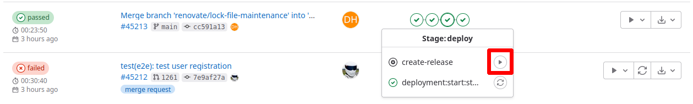
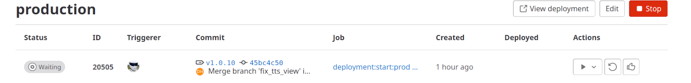

# Creating a new Release

After including "auto-release.yml" from the base-pipeline into a project,
it's possible to create automated releases from the main branch.

NOTE: This requires at least Maintainer permissions on the repository.

In "Pipelines" under the "Build" section of the gitlab project, click on the deploy stage
and then click on the triangle button next to "create-release".

This will create a new release with a new tag and attach an automatically generated changelog
based on the commit messages.

It will also trigger a pipeline that is ready to deploy to production, however it still requires
additional confirmation.

To see the waiting release, click on "Operate", "Environments" and then "production".

To approve the deployment to production, click on the "thumbsup" icon on the right and "Approve", this most likely needs
to be done by a different person with Maintainer permissions.

It's usually a good idea to inform the users that an update is now in progress, in case there are any complications.

Then the release job can be run by clicking the button with "waiting" and the gear icon and then "Run Job".

Now monitor the deployed application to make sure the update completed without issues.
